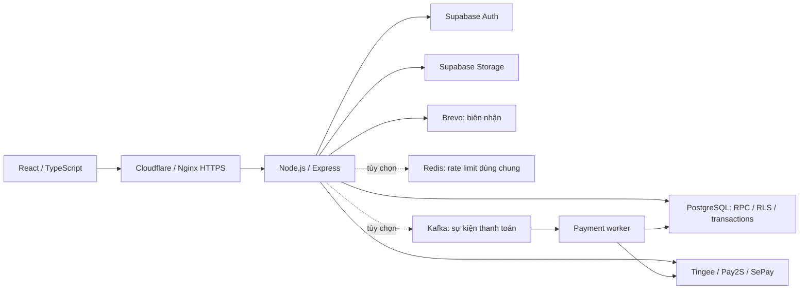

# KEYNEST

KEYNEST là website bán game key, gift card, gói nạp game và sản phẩm/dịch vụ số, có gian hàng của người bán, ví mua hàng, thanh toán chuyển khoản và khu vực quản trị. Frontend dùng React + TypeScript; API dùng Node.js + Express; chế độ vận hành thật dùng Supabase Auth, PostgreSQL và Storage.

Đây là tài liệu chính của dự án: chức năng, kiến trúc, cài đặt database, cấu hình, triển khai và vận hành. Dịch vụ bên ngoài chỉ hoạt động khi được cấu hình bằng tài khoản và thông tin kết nối hợp lệ.

## Nội dung

- [Chức năng và quy tắc nghiệp vụ](#features)
- [Kiến trúc và mã nguồn](#architecture)
- [Chạy thử trên máy](#local)
- [Cài đặt database](#database)
- [Biến môi trường](#configuration)
- [Đăng nhập, email và bảo mật](#authentication)
- [Thanh toán](#payments)
- [Chat và cập nhật trực tiếp](#realtime)
- [Ảnh và tài nguyên](#assets)
- [Nhóm API](#api)
- [Triển khai GitHub Actions → VPS](#deployment)
- [Kiểm tra](#verification)
- [Sao lưu và khôi phục](#backup)
- [Xử lý lỗi](#troubleshooting)
- [Quy tắc GitHub và giới hạn](#repository)

<a id="features"></a>
## Chức năng và quy tắc nghiệp vụ

| Vai trò | Chức năng |
| --- | --- |
| Khách chưa đăng nhập | Xem danh mục, tìm kiếm, lọc/sắp xếp, ưu đãi, chi tiết và chính sách trong khu vực được phục vụ |
| Khách hàng | Đăng ký/đăng nhập, Google/Discord, quản lý hồ sơ/phiên/2FA, giỏ hàng theo tài khoản, mua bằng ví/chuyển khoản, nhận hàng, bảo hành, đánh giá và chat |
| Người bán | Quản lý sản phẩm/gói, nhập kho, gửi sản phẩm để xét duyệt, giao hàng, chat theo sản phẩm trong đơn, thu nhập, đề nghị rút tiền/đổi tên gian hàng |
| Admin | Duyệt seller/sản phẩm/tên gian hàng, quản lý danh mục/banner/coupon/kho/đơn, giao dịch vụ, đối soát, hoàn tiền/tranh chấp/rút tiền, tài khoản và nhật ký |

**Danh mục.** Nhiều nhóm hàng, nền tảng, khu vực, biến thể, tồn kho, loại giao và ghi chú sử dụng. Banner, menu, khuyến mãi, sản phẩm vừa xem và ảnh sản phẩm có phần quản lý riêng. Đánh giá gồm điểm sao và nội dung nhận xét trong cùng khu vực; API bình luận cũ vẫn được giữ để tương thích.

**Đơn và kho.** Giá, coupon, phí và tồn kho tính trên server. Đặt hàng có khóa chống xử lý trùng; checkout cập nhật giỏ theo lượng đã mua. Đơn chuyển khoản giữ kho 15 phút; hủy/hết hạn nhả phần chưa giao. Mã hàng và nội dung giao mã hóa AES-256-GCM. Hỗ trợ mã riêng, mã dùng chung không giới hạn và giao thủ công cho dịch vụ cần UID/server/thông tin khách. Key đã giao không tự nhập lại kho khi hoàn tiền.

**Đặt trước và bảo hành.** Điều kiện gói, ngày giao dự kiến, bảo hành và chấp thuận được lưu theo giao dịch. Bảo hành tính từ thời điểm giao tương ứng. Khách xem đơn, dữ liệu nhận hàng và tải thông tin giao dịch. Email biên nhận tùy chọn qua Brevo có hàng đợi, lease và thử lại khi lỗi.

**Ví.** Số dư mua hàng nội bộ, có lịch sử nạp/mua/hoàn/đối soát. Mã thanh toán, tài khoản nhận, số tiền và sự kiện nhà cung cấp được kiểm tra để tránh ghi nhận trùng. Hoàn từng sản phẩm chỉ thu hồi thu nhập tương ứng. Ghi nhận hoàn ngoài hoặc duyệt rút tiền không tự chuyển khoản ngân hàng.

**Gian hàng.** Seller được cấp quyền và xác nhận điều kiện bán hàng. Sản phẩm/thay đổi phải qua xét duyệt; bản duyệt gắn với phiên bản sản phẩm để tránh duyệt dữ liệu cũ. Tên gian hàng mới chỉ có hiệu lực sau khi admin duyệt; trong lúc chờ vẫn hiển thị tên đã được chấp thuận.

Phí bán hàng được chụp lại theo giao dịch, mặc định 7%; phân bổ tiền bằng số nguyên VND. Thực nhận giữ đến 48 giờ sau khi từng sản phẩm được giao. Tranh chấp mở/đã đồng ý giữ phần tiền liên quan; sản phẩm khác vẫn có thể tiếp tục xử lý. Tranh chấp chưa giải quyết sau thời hạn cần admin xử lý. Hoàn tiền thu hồi thu nhập, có thể hủy yêu cầu rút đang chờ hoặc tạo khoản bù trừ nếu đã quyết toán.

Thống kê theo thời điểm đặt đơn: **doanh thu, phí và thực nhận loại phần đã hoàn/thu hồi**; thu nhập đã thu hồi hiển thị riêng. Thực nhận trong kỳ khác số dư có thể rút. Yêu cầu rút từ 50.000 đến 100.000.000 VND, không vượt số dư đủ điều kiện và không có nợ phải bù; tiền được giữ ngay khi tạo yêu cầu. Admin chuyển khoản bên ngoài rồi ghi nhận kết quả; từ chối trả lại tiền đã giữ.

<a id="architecture"></a>
## Kiến trúc và mã nguồn



Trình duyệt gọi API ứng dụng; `service_role` chỉ nằm trên backend. Auth xác minh danh tính, vai trò/quyền lấy từ database. Tiền, tồn kho, hoàn và phê duyệt quan trọng dùng hàm PostgreSQL có transaction. Demo là adapter tệp riêng, không phải dự phòng khi Supabase lỗi.

| Đường dẫn | Trách nhiệm |
| --- | --- |
| [src/](src/) | React/TSX, router, API client, giỏ hàng, storefront và các trang tài khoản/seller/admin |
| [server/index.js](server/index.js) | HTTP/API, middleware, route chính và gắn WebSocket |
| [server/supabase-store.js](server/supabase-store.js) | Adapter dữ liệu thật và RPC |
| [server/demo-store.js](server/demo-store.js) | Mô phỏng nghiệp vụ cho development/test |
| [server/security.js](server/security.js) | Mã hóa kho và bảo vệ request |
| [server/chat-live.js](server/chat-live.js) | Vé kết nối, phân quyền và truyền chat |
| [server/](server/) | OAuth, MFA, OTP admin, thanh toán, recovery, seller, media, thông báo và rate limit |
| [shared/](shared/) | Danh mục mẫu, điều khoản/chính sách có phiên bản và dữ liệu dùng chung |
| [supabase/database.sql](supabase/database.sql) | SQL gộp để cài schema và trích bước nâng cấp |
| [supabase/email-templates/](supabase/email-templates/) | HTML recovery và OTP để cài trong Supabase |
| [public/](public/) và [src/assets/](src/assets/) | Tài nguyên thực sự được website sử dụng |
| [scripts/](scripts/) và [tests/](tests/) | Setup, seed, build, kiểm tra SQL/API/UI và công cụ vận hành |
| [deploy/](deploy/) | Nginx, systemd, release script và Cloudflare Worker |
| [.github/workflows/deploy.yml](.github/workflows/deploy.yml) | Kiểm tra, đóng gói và deploy VPS |

<a id="local"></a>
## Chạy thử trên máy

Yêu cầu Node.js 22.12+ hoặc 24 và npm. Từ thư mục repo:

```powershell
npm ci
npm run setup
npm run dev
```

`setup` tạo `.env` và khóa mã hóa chỉ khi chưa có; nếu đã có thì giữ nguyên. Mở `http://127.0.0.1:5173`, API ở `http://127.0.0.1:3001`. `APP_ORIGIN` phải khớp chính xác địa chỉ trình duyệt, kể cả `localhost`/`127.0.0.1` và cổng.

Mặc định `APP_MODE=demo`, dữ liệu ở `.data/demo.json`; thanh toán mô phỏng, không nhận tiền thật. Demo bị chặn khi `NODE_ENV=production`.

| Tài khoản demo | Email | Mật khẩu |
| --- | --- | --- |
| Khách | `student@keynest.local` | `Student123!` |
| Admin | `admin@keynest.local` | `Admin123!` |

Khách mẫu có 1.500.000 VND mô phỏng; đăng ký mới bắt đầu 0 VND. Admin mở `/admin`. Seed không đưa tài khoản/mã demo vào Supabase.

`npm run dev:api` chỉ chạy API. Sau build, có thể thử website trên Node bằng `npm start` với `APP_ORIGIN=http://127.0.0.1:3001`, `APP_MODE=demo`, `NODE_ENV=development`.

<a id="database"></a>
## Cài đặt database

[database.sql](supabase/database.sql) định nghĩa schema, index, trigger, RLS, grants và RPC của ứng dụng. File này dùng để cài đặt cấu trúc database, không chứa backup dữ liệu khách hàng và không thay thế schema `auth`/`storage` do Supabase quản lý.

Mỗi bước có mốc `-- KEYNEST STEP ... BEGIN/END` và cần thực hiện theo thứ tự. Khi bổ sung schema, thêm bước mới vào cuối file với số tiếp theo.

### Project Supabase mới

1. Tạo project riêng, mở SQL Editor và chạy **toàn bộ** `supabase/database.sql` một lần, trước khi tạo tài khoản ứng dụng.
2. Điền `APP_MODE=supabase`, URL project, anon key, service role key và khóa mã hóa trong `.env`. Không dùng `VITE_` cho secret.
3. Cấu hình Auth, SMTP, redirect và thanh toán theo các mục bên dưới.
4. Chạy `npm run seed` nếu cần danh mục mẫu. Seed giữ sản phẩm đã tồn tại và không nhập mã demo vào kho thật. Gói giao mã cần admin nhập kho trước khi bán.
5. Đăng ký tài khoản admin trên website, hoàn thành xác minh theo cấu hình Auth rồi cấp quyền trong SQL Editor:

```sql
update public.profiles
set role = 'admin'
where id = (select id from auth.users where email = 'YOUR_ADMIN_EMAIL');
```

Nếu user đã có trước schema ứng dụng, kiểm tra profile gắn đúng `auth.users.id`. Không cấp quyền quản trị từ metadata phía trình duyệt.

### Cập nhật schema

**Không chạy lại toàn bộ bản gộp trên schema đã có, không xóa database để dùng bản gộp.** Xác nhận bước cuối đã chạy thành công, chỉ lấy bước còn thiếu:

```powershell
npm run db:sql -- --list
# Ví dụ: project đã chạy thành công đến 056.
node scripts/database-sql.js --after 056 > database-pending.sql
```

Xem trước tệp rồi chạy phần nâng cấp cần thiết trong SQL Editor sau khi sao lưu. Công cụ chỉ xuất SQL, không kết nối database. Dùng lệnh `node` khi chuyển hướng để không lẫn banner npm vào SQL. PowerShell cũ có thể xuất UTF-16; chọn UTF-8 khi mở/lưu lại bằng editor.

`--after 000` dành cho schema ứng dụng mới hoàn toàn. Trích theo số bước giả định các bước trước đã chạy đầy đủ. SQL Editor không tự tạo lịch sử migration của Supabase CLI. Nếu một bước từng chạy một phần bị lỗi, kiểm tra trạng thái thực tế trước khi tiếp tục.

SQL trích xuất tạm không đưa lên GitHub. Pipeline không tự chạy SQL trên Supabase thật.

### Nhóm dữ liệu và quyền

| Nhóm | Nội dung |
| --- | --- |
| Danh tính | Profile, vai trò, điều khiển tài khoản, phiên riêng tư, chấp thuận, lịch sử mật khẩu |
| Cửa hàng | Sản phẩm, biến thể, danh mục, banner, coupon, kho mã hóa và giỏ hàng |
| Giao dịch | Đơn/từng sản phẩm trong đơn, payment route, sự kiện thanh toán, số dư, sổ giao dịch, đối soát |
| Người bán | Xét duyệt sản phẩm, đổi tên, thu nhập giữ/khả dụng/thu hồi, rút tiền và bù trừ |
| Hỗ trợ | Bảo hành, đánh giá, ticket, tin nhắn theo đơn, hoàn tiền và thông báo |
| Vận hành | Audit log, nonce dùng một lần, recovery request, biên nhận email, lịch kiểm tra Tingee |

Bảng nghiệp vụ có RLS và giới hạn quyền trực tiếp `anon`/`authenticated`; backend kiểm tra actor/quyền sở hữu trước khi dùng `service_role`. Khóa này có quyền cao nên RLS không thay thế bảo vệ khóa. Phép cộng/trừ tiền và kho phải đi qua RPC hiện có để giữ tính nguyên tử/chống trùng.

<a id="configuration"></a>
## Biến môi trường

[.env.example](.env.example) là danh sách đầy đủ. `.env` thật chỉ nằm trên máy chạy ứng dụng. `VITE_*` đi vào frontend lúc build và phải là dữ liệu công khai.

| Nhóm | Biến và cách dùng |
| --- | --- |
| Runtime | `APP_MODE=demo/supabase`, `NODE_ENV`, `PORT` (3001), `APP_ORIGIN` không có path; production cần HTTPS/Supabase |
| Supabase | `SUPABASE_URL`, `SUPABASE_ANON_KEY`, `SUPABASE_SERVICE_ROLE_KEY`; backend sử dụng |
| Mã hóa | `INVENTORY_ENCRYPTION_KEY`: 64 ký tự hex = 32 byte, giữ ổn định với DB đang dùng |
| OAuth | `AUTH_GOOGLE_ENABLED`, `AUTH_DISCORD_ENABLED`; chỉ bật provider đã cấu hình |
| CAPTCHA | `RECAPTCHA_ENABLED`, `RECAPTCHA_SITE_KEY`, `RECAPTCHA_SECRET_KEY`; v2 Checkbox |
| Cổng QR | `BANK_PAYMENT_PROVIDER=tingee/pay2s/sepay`, mặc định Tingee |
| Tingee | `TINGEE_QR_MODE` (bản mẫu `dynamic`), `TINGEE_CLIENT_ID`, `TINGEE_SECRET_TOKEN`, `TINGEE_BANK_BIN`, `TINGEE_VA_ACCOUNT`, `TINGEE_ACCOUNT_NAME`, `TINGEE_BASE_URL`, `TINGEE_MERCHANT_ID` nếu cần |
| Pay2S | `BANK_CODE`, `BANK_ACCOUNT_NUMBER`, `BANK_ACCOUNT_NAME`, `PAY2S_WEBHOOK_TOKEN`; cũng dùng dự phòng Tingee |
| SePay | `SEPAY_WEBHOOK_KEY`, `SEPAY_BANK`, `SEPAY_ACCOUNT_NUMBER`, `SEPAY_ACCOUNT_NAME` |
| Proxy | `TRUST_PROXY=0` nếu gọi Node trực tiếp; tăng theo topology proxy thực sự tin cậy |
| Kafka | `KAFKA_ENABLED`, `KAFKA_BROKERS`, `KAFKA_PAYMENT_TOPIC`, `KAFKA_PAYMENT_GROUP`, `KAFKA_CLIENT_ID`, `KAFKA_WORKER_CONCURRENCY`, `KAFKA_SSL`, `KAFKA_USERNAME`, `KAFKA_PASSWORD`, `KAFKA_SASL_MECHANISM` |
| Topic | `KAFKA_TOPIC_REPLICATION_FACTOR`, `KAFKA_TOPIC_MIN_ISR`; giá trị 1 của bản mẫu cho local một broker |
| Redis | `REDIS_ENABLED`, `REDIS_URL`, `REDIS_PREFIX`; tắt thì giới hạn trong RAM một API process |
| Biên nhận | `ORDER_RECEIPTS_ENABLED`, `BREVO_API_KEY`, `ORDER_RECEIPTS_FROM`; API key khác SMTP của Supabase |
| Footer | `VITE_DISCORD_URL`, `VITE_FACEBOOK_URL`; sửa thì restart Vite/build lại production |

`npm run check:config` kiểm tra sự hiện diện/hình thức cấu hình Supabase/HTTPS, không gọi nhà cung cấp hay chứng minh credentials hợp lệ. Demo không đáp ứng kiểm tra production này. Không in `.env` khi báo lỗi.

<a id="authentication"></a>
## Đăng nhập, email và bảo mật

### Phiên, quyền và mật khẩu

Supabase Auth xác minh email/mật khẩu và Google/Discord. Cookie xác thực dùng `HttpOnly`, `SameSite=Lax`, `Secure` ở production; access token có thể giữ trong bộ nhớ ứng dụng. Quyền nghiệp vụ lấy từ profile/phiên server; kiểm tra khóa tài khoản, thu hồi phiên, MFA và OTP admin cho thao tác cần bảo vệ.

Request thay đổi dữ liệu từ browser cần Origin đúng và `X-App-Request: keynest`. Zod kiểm tra input; có rate limit, giới hạn body/header bảo mật/quyền sở hữu. Luồng mật khẩu dùng JWE `ECDH-ES` + `A256GCM`, nonce gắn endpoint, hạn 120 giây, dùng một lần trong DB; vẫn cần HTTPS. Thiếu schema nonce thì từ chối thay vì bỏ kiểm tra.

Mật khẩu 10–128 ký tự, gồm hoa/thường/số. Đổi/reset chặn mật khẩu hiện tại và mật khẩu đã thay thế trong 30 ngày. Không lưu mật khẩu rõ trong hồ sơ cửa hàng. Thay trực tiếp ngoài ứng dụng không đi qua toàn bộ chính sách API; cần hạn chế quyền quản trị Supabase.

### Chống thử mật khẩu và spam OTP

Sai mật khẩu 5 lần trong 15 phút thì tài khoản bắt buộc xác minh OTP email và CAPTCHA trước khi đặt mật khẩu mới. Trạng thái lưu trên server, không mất khi quay lại, tải trang, đổi trình duyệt/IP hay restart API. Chỉ đổi mật khẩu thành công hoặc admin mở khóa mới gỡ yêu cầu này. Gửi OTP cần CAPTCHA, chờ ít nhất 90 giây giữa hai email; xác minh mã cần CAPTCHA mới và tối đa 5 lượt thử trong cửa sổ giới hạn. Không tự gửi email chỉ vì ai đó nhập sai mật khẩu.

Spam gửi hoặc nhập sai OTP vượt giới hạn sẽ khóa luồng OTP theo tài khoản: 30 phút, 1 giờ, 2 giờ và tiếp tục gấp đôi, tối đa **365 ngày**. Request trong thời gian khóa không gửi mail hoặc kéo dài thời điểm hết khóa. Sau khi hết hạn, đợt vi phạm tiếp theo tăng mức khóa; trở về trang đăng nhập vẫn cần OTP. Đây là khóa luồng xác minh, không phải vô hiệu hóa toàn bộ tài khoản. Admin có nút **Mở khóa OTP** trong danh sách khách hàng, có kiểm tra quyền và ghi audit log.

Trong thời gian khóa OTP, gửi email/mật khẩu ở màn hình đăng nhập sẽ bị chặn ngay, kể cả mật khẩu đúng, và hiển thị thời điểm được thử lại. Hết thời gian khóa vẫn cần OTP + CAPTCHA; mật khẩu đúng không tự gỡ yêu cầu xác minh.

Triển khai tính năng cần áp dụng bước `058_login_protection` trước khi cập nhật API và bật reCAPTCHA v2 với key hợp lệ. Email mã dùng mẫu Magic Link `otp.html` hiện có; không tạo user mới khi yêu cầu mã. OTP chỉ cấp vé đặt mật khẩu một lần, không cấp phiên đăng nhập cho trình duyệt trước khi đặt mật khẩu. Chức năng email này cần Supabase, không gửi mail trong demo.

### OAuth và Authenticator

1. Bật provider trong Supabase Authentication → Providers, điền client ID/secret tại Supabase.
2. Provider callback: `https://PROJECT.supabase.co/auth/v1/callback`.
3. Site URL là `APP_ORIGIN`; cho phép redirect `APP_ORIGIN/api/auth/oauth/callback`.
4. Đặt cờ `AUTH_GOOGLE_ENABLED`/`AUTH_DISCORD_ENABLED=true` tương ứng, restart API. PKCE/callback xử lý trên backend.

Người dùng bật 2FA Authenticator và quản lý phiên trong tài khoản. Admin bật 2FA cần cả Authenticator và OTP email, hai bước riêng.

### OTP admin và email recovery

Chế độ Supabase bắt buộc admin xác minh email OTP cho phiên mới, kể cả OAuth, tại `/admin-verification`. `ADMIN_OTP_ENABLED=false` không tắt được. Gửi mail lỗi thì không cấp quyền admin. OTP gắn người dùng/email/phiên; có giới hạn gửi lại và thử mã.

Supabase Authentication → Email Templates:

| Mẫu | File/mục đích |
| --- | --- |
| Reset Password | [recovery.html](supabase/email-templates/recovery.html): liên kết đặt mật khẩu |
| Magic Link | [otp.html](supabase/email-templates/otp.html): OTP email admin và xác minh đặt lại mật khẩu |
| Confirm signup | Giữ liên kết xác minh theo cấu hình đăng ký, không thay bằng OTP admin |

SMTP cấu hình riêng; HTML không thiết lập gửi thư. Giữ nguyên placeholder `{{ .Token }}`, `{{ .TokenHash }}`, `{{ .RedirectTo }}` ở mẫu tương ứng. Mẫu dùng bảng/inline CSS, không cần JavaScript/ảnh/font ngoài.

Yêu cầu recovery từ Quên mật khẩu của website. Redirect cần `https://TEN-MIEN/reset-password\?recovery_id=*` (thay domain; dấu `\?` cho biểu thức redirect). Token trong fragment `#token_hash=...`, không ở query/Site URL. Không đổi sang `{{ .ConfirmationURL }}` vì trình quét link có thể dùng token trước người nhận. Tắt click tracking SMTP cho luồng này.

Link và vé đặt mật khẩu hạn 10 phút, một lần; mở trang tiêu thụ link, reload cần email mới. Chờ tối thiểu 90 giây giữa yêu cầu hoặc lâu hơn nếu Supabase giới hạn. Yêu cầu mới thay thế thế hệ cũ sau khi provider chấp nhận gửi. Dashboard preview không chứng minh email/luồng xác thực hoạt động; cần thử bằng email mới.

<a id="captcha"></a>
### reCAPTCHA

Tạo key **v2 Checkbox**, thêm hostname đúng, đặt `RECAPTCHA_ENABLED=true` và cặp site/secret trên backend. Frontend lấy site key qua `/api/config`; secret không công khai. Backend kiểm tra token/hostname cho login email, đăng ký và quên mật khẩu; OAuth không cần CAPTCHA này. Đổi key restart API; lỗi xác minh không tự cho qua. Key v3/Invisible/Enterprise không tương thích adapter hiện tại.

Chính sách có phiên bản ở [shared/legal-content.js](shared/legal-content.js), lưu bản cũ tại [shared/legal-archive/](shared/legal-archive/). Chấp thuận đăng ký/đặt hàng lưu để đối chiếu. Chủ website cần cập nhật thông tin vận hành/liên hệ/quy trình xử lý dữ liệu theo thực tế.

<a id="payments"></a>
## Thanh toán

### Tingee mặc định, Pay2S dự phòng

```dotenv
BANK_PAYMENT_PROVIDER=tingee
TINGEE_QR_MODE=dynamic
TINGEE_BANK_BIN=970422
TINGEE_VA_ACCOUNT=YOUR_LINKED_MBBANK_VA
TINGEE_ACCOUNT_NAME=YOUR_ACCOUNT_NAME
TINGEE_CLIENT_ID=YOUR_CLIENT_ID
TINGEE_SECRET_TOKEN=YOUR_SECRET_TOKEN
TINGEE_BASE_URL=https://open-api.tingee.vn
BANK_CODE=MB
BANK_ACCOUNT_NUMBER=YOUR_PAY2S_ACCOUNT
BANK_ACCOUNT_NAME=YOUR_PAY2S_ACCOUNT_NAME
PAY2S_WEBHOOK_TOKEN=YOUR_WEBHOOK_TOKEN
```

Dùng VA liên kết/cấp cho tài khoản Tingee, không tự thay bằng số tài khoản thường. Merchant ID chỉ điền khi loại credentials yêu cầu. Adapter hỗ trợ QR động/tĩnh, chỉ gọi môi trường được chấp nhận; credentials phải khớp production/UAT.

Backend lưu route/bill theo giao dịch, truy vấn trạng thái Tingee và kiểm tra bill/số tiền/thời điểm trước quyết toán; không cần webhook Tingee. Lịch kiểm tra dùng lease/backoff lưu DB để hạn chế gọi lặp. Tạo QR Tingee lỗi và Pay2S sẵn sàng thì **giao dịch mới** có thể dùng Pay2S; QR đã phát hành giữ nguyên cổng. Không yêu cầu trả lần hai chỉ vì xác nhận chậm.

Pay2S: `POST https://TEN-MIEN/api/webhooks/pay2s`, `Authorization: Bearer <PAY2S_WEBHOOK_TOKEN>`. Biến môi trường chỉ chứa token, không có chữ `Bearer`. Liên kết đúng tài khoản nhận tại provider, giữ webhook cho QR Pay2S còn chờ.

### SePay và đối soát

Đặt `BANK_PAYMENT_PROVIDER=sepay`, thông tin ngân hàng và `SEPAY_WEBHOOK_KEY`. Webhook tiền vào `POST /api/webhooks/sepay`, `Authorization: Apikey <key>`. Đây là Bank Transfer Webhook, không phải Payment Gateway SDK.

Mã giao dịch dạng `KN` + 16 ký tự hex. Kiểm tra tài khoản/nội dung/số tiền; webhook lặp không cộng tiền lần nữa. Sai tiền/mã, chuyển thêm, đơn hủy/hết hạn vào đối soát. Admin kiểm chứng, chọn khách và ghi lý do trước khi cộng số tiền thực nhận vào ví. Tingee có thể xác nhận muộn khoản nạp ví nếu thời điểm trả trước hạn; đơn đến muộn cần đối soát vì hàng có thể đã nhả.

### Kafka và Redis tùy chọn

Mặc định tắt. [compose.infrastructure.yml](compose.infrastructure.yml) phục vụ local. Sau cấu hình broker: `npm run infra:topics`, `npm run infra:status`, `npm run test:infra`. Bật Kafka ở Supabase thì chạy thêm `npm run worker:payments` hoặc service worker.

Sự kiện phân vùng theo thanh toán/tài khoản; consumer commit offset sau RPC thành công. Database chống trùng khi phát lại, không phải bảo đảm exactly-once toàn hệ thống. Redis dùng rate limit chung; đã bật mà lỗi có thể trả 503 thay vì bỏ giới hạn. Compose một broker/replica không phải production dự phòng.

<a id="realtime"></a>
## Chat và cập nhật trực tiếp

Chat đơn, seller-support và ticket dùng `/api/chat/live`. `POST /api/chat/live-ticket` cấp vé một lần hạn 30 giây, gắn topic/quyền người xem, kèm lịch sử để hiển thị trước khi socket mở. Server đồng bộ lại sau Upgrade để nhận tin phát sinh trong khoảng chuyển tiếp.

Vé qua subprotocol, không đặt bearer/refresh token trong URL. Origin phải khớp; kiểm tra phiên/MFA/OTP/quyền khi gửi/cập nhật. Ping 25 giây không đọc DB; gia hạn 5 phút; reconnect tăng dần khoảng 1–30 giây. Giữ bản nháp; không tự gửi lại lệnh chưa xác nhận. Snapshot chat đơn tối đa 200 tin gần nhất; không GET chat định kỳ.

Giới hạn 6 kết nối/tài khoản, 500/process, frame 16 KiB, kèm giới hạn lệnh/hàng đợi. Hub/vé ở RAM của **một API process**. Nhiều process/replica cần chia sẻ vé/phát sự kiện phù hợp; payment worker không làm nhiệm vụ này. Ghi trực tiếp DB ngoài ứng dụng không tự phát sự kiện chat.

Danh mục công khai dùng SSE, lượt đọc dùng chung và fingerprint; client có fallback khi mất kết nối. Đơn/thông báo/thanh toán có lịch cập nhật riêng. Không cần bật Supabase Realtime cho chat này.

<a id="assets"></a>
## Ảnh và tài nguyên

Backend kiểm tra/chuẩn hóa ảnh bằng Sharp, phục vụ `/api/media/...`. Ảnh sản phẩm JPG/PNG/WebP tối đa 8 MB theo giao diện; avatar 4 MB, đổi WebP tối đa 512px, bỏ metadata. Proxy cần giới hạn body phù hợp. Supabase dùng bucket `store-assets`, hồ sơ lưu đường dẫn. URL ảnh hiển thị công khai không phải cách giữ bí mật dữ liệu.

Giữ ảnh tĩnh `public/images/`, favicon và `src/assets/campaigns/` vì website sử dụng. URL cũ có thể lưu trong DB, không xóa chỉ vì thiếu import. Ảnh UI/biểu đồ báo cáo/preview ngoài thư mục tài nguyên là local.

Banner Elden Ring (`1245620`), Black Myth: Wukong (`2358720`), Cyberpunk 2077 (`1091500`) từ Steam public artwork CDN ngày 06/11/2026, mẫu `https://shared.fastly.steamstatic.com/store_item_assets/steam/apps/APP_ID/library_hero.jpg`. Mỗi game có WebP 640/1280px và preview 48px. Sharp không phóng lớn, quality 77/effort 6; preview blur 0.5/quality 45. Quyền ảnh/thương hiệu thuộc chủ sở hữu tương ứng.

<a id="api"></a>
## Nhóm API

API dưới `/api`; dữ liệu riêng cần phiên hợp lệ, mutation từ browser cần header chống CSRF. Actor/role không lấy từ client tự khai. Route cụ thể ở [server/index.js](server/index.js) và các module gắn tại đó.

| Nhóm | Route tiêu biểu |
| --- | --- |
| Công khai | `GET /api/health`, `/api/config`, `/api/region`, `/api/products`, `/api/products/:id`, danh mục/tìm kiếm/khuyến mãi |
| Auth | `/api/auth/password-key`, `/api/auth/login`, `/api/auth/register`, `/api/auth/refresh`, `/api/auth/logout`; OAuth/MFA/OTP/recovery theo module |
| Tài khoản | `GET/PATCH /api/me`, avatar, mật khẩu, quản lý phiên |
| Giỏ/đơn | `GET/PUT /api/cart`, `GET/POST /api/orders`, chi tiết/hủy/bảo hành/thông tin giao dịch |
| Ví/thanh toán | `GET /api/wallet`, tạo nạp, trạng thái; webhook Pay2S/SePay xác thực provider |
| Hỗ trợ | Ticket, phản hồi, đánh giá sau mua; `/api/chat/live-ticket`, `/api/chat/live` |
| Seller | Sản phẩm/gói/kho, giao đơn, thu nhập/rút tiền, hồ sơ/đổi tên/hỗ trợ |
| Admin | Kho/sản phẩm, giao/hoàn, tài khoản, coupon/banner/danh mục, đối soát/log, xét duyệt |

Admin yêu cầu role cùng xác minh bổ sung áp dụng. Tiền là số nguyên VND, không gửi chuỗi có dấu phân cách làm số API. Giữ idempotency/request ID cho cùng thao tác thử lại theo client hiện có. Tạo QR thành công không thay trạng thái quyết toán DB.

<a id="deployment"></a>
## Triển khai GitHub Actions → VPS

Production dùng Supabase, HTTPS, một API process. Node phục vụ `dist/` và `/api`, Nginx reverse proxy. Website không cần Docker; GitHub build/test để VPS không phải build frontend.

### Chuẩn bị lần đầu

Trên Ubuntu cài Node.js 24/npm, Nginx, Certbot/plugin Nginx. Tạo user `keynest`, `/opt/keynest/releases`, `/opt/keynest/incoming`, cấp quyền user đó. Sau deploy:

```text
/opt/keynest/
  .env                # cấu hình thật ngoài release
  incoming/           # upload/checksum
  releases/           # code mỗi bản
  current -> releases/RELEASE_ID
```

Tạo `.env` từ mẫu **chỉ nếu chưa có**, quyền 600, owner `keynest`. Giữ khóa kho nếu đang vận hành. Đặt production/Supabase/origin HTTPS và thông tin thanh toán/SMTP thực tế; chỉ bật provider đã cấu hình. Chặn truy cập Internet trực tiếp cổng 3001; mở SSH/80/443 theo hạ tầng.

Cài [keynest.service](deploy/keynest.service) vào `/etc/systemd/system/`, `sudo systemctl daemon-reload`, `sudo systemctl enable keynest`. Chạy user `keynest`, workdir `current`, heap 384 MB, restart khi lỗi. Bản đầu tạo `current` rồi start service. Worker tùy chọn [keynest-payments.service](deploy/keynest-payments.service), chỉ bật nếu cần và đủ cấu hình.

SSH deploy key riêng, public key vào `authorized_keys` user deploy. Cấp sudo giới hạn cho lệnh service mà [release.sh](deploy/release.sh) dùng: restart/stop `keynest`, thêm worker tương ứng nếu bật; không cấp sudo toàn quyền. Đối chiếu fingerprint host key từ console/VPS đáng tin trước khi lưu GitHub. `ssh-keyscan` một mình không xác minh server.

### Nginx, HTTPS và WebSocket

[deploy/nginx.conf](deploy/nginx.conf) là mẫu; thay `shop.example.com`. Site đã có Certbot thì sửa đúng block hoạt động, giữ chứng chỉ. Location sau phải ở **block HTTPS**, không chỉ port 80:

```nginx
location = /api/chat/live {
    proxy_pass http://127.0.0.1:3001;
    proxy_http_version 1.1;
    proxy_set_header Upgrade $http_upgrade;
    proxy_set_header Connection "upgrade";
    proxy_set_header Host $host;
    proxy_set_header X-Real-IP $remote_addr;
    proxy_set_header X-Forwarded-For $remote_addr;
    proxy_set_header X-Forwarded-Proto $scheme;
    proxy_read_timeout 75s;
    proxy_send_timeout 75s;
    proxy_buffering off;
}
```

```bash
sudo nginx -t
sudo systemctl reload nginx
# Lần đầu khi domain trỏ đúng và HTTP hoạt động:
sudo certbot --nginx -d TEN-MIEN
sudo certbot renew --dry-run
```

`TRUST_PROXY=1` chỉ khi tin đúng một proxy theo topology thực tế. Có Cloudflare thì thiết lập Nginx/real IP/proxy tin cậy phù hợp, không tin mọi `X-Forwarded-For`. Workflow không tự chép cấu hình mẫu vào Nginx.

### Secrets và workflow

Settings → Secrets and variables → Actions:

| Loại | Tên |
| --- | --- |
| Secrets | `VPS_HOST`, `VPS_PORT` (thường 22), `VPS_USER`, `VPS_SSH_KEY`, `VPS_KNOWN_HOSTS` |
| Variable deploy | `VPS_DEPLOY_ENABLED=true` |
| Variables công khai | `VITE_DISCORD_URL`, `VITE_FACEBOOK_URL` để thay liên kết build mặc định |

Supabase/service role/encryption key giữ trong `.env` VPS; CI không cần secret production. Push `main`: cài dependency → kiểm tra repo → audit production → test API/SQL → build → kiểm tra release script → đóng gói/checksum → SSH upload/kích hoạt. PR chỉ kiểm tra. Deploy chỉ main khi bật biến; có thể chạy Actions → Test and deploy KEYNEST → Run workflow.

Release script khóa triển khai đồng thời, kiểm tra đường dẫn/checksum, cài production dependency, chuyển symlink `current`, restart và kiểm tra health/commit. Lỗi thì thử khôi phục code trước; thành công giữ bản hiện tại và rollback. Giữ `.env` ngoài release. Restart có gián đoạn ngắn; rollback code không rollback DB.

```bash
sudo systemctl status keynest --no-pager
curl -f http://127.0.0.1:3001/api/health
curl -f http://127.0.0.1:3001/release.txt
sudo journalctl -u keynest -n 100 --no-pager
readlink -f /opt/keynest/current
```

Sau deploy thử HTTPS/login/OTP/ảnh/giỏ/chat 101/đơn/thanh toán/thông báo. Health chỉ chứng minh API chạy, không chứng minh email/DB/ngân hàng. Sửa `.env` restart API/worker; sửa `VITE_*` cần build lại.

### Cloudflare giới hạn Việt Nam

Worker sinh từ [cloudflare-country-handler.js](deploy/cloudflare-country-handler.js) và nội dung dùng chung:

```powershell
node scripts/build-country-worker.js
```

Dán toàn bộ [cloudflare-vietnam-worker.js](deploy/cloudflare-vietnam-worker.js) vào Worker rồi Deploy, gắn route `keynest.store/*` gồm `/api`. Git push không tự cập nhật Worker. Bản hiện tại `vietnam-region-v6` lấy `request.cf.country`: VN đến origin, ngoài VN thấy giới hạn, vẫn đọc `/privacy`/`/terms`. POST Pay2S/SePay đến backend vẫn phải xác thực provider; header/User-Agent không có ngoại lệ quốc gia.

Sửa chính sách thì build/deploy lại Worker. WAF chặn trước Worker có thể chặn cả trang chính sách; kiểm tra thứ tự/ngoại lệ. Bảo vệ origin khỏi truy cập vòng qua edge. Giới hạn vùng có thể ảnh hưởng bot kiểm tra trang chủ; deploy code không chứng minh Google đã duyệt thương hiệu.

<a id="verification"></a>
## Kiểm tra

```powershell
npm run check:repo
npm test
npm run test:db
npm run build
```

| Lệnh | Phạm vi |
| --- | --- |
| `check:repo` | Git index: README chính, báo cáo/ảnh phụ/secret theo tên, liên kết README và tính nhất quán của SQL |
| `npm test` | Nghiệp vụ/API/bảo mật/thanh toán/chat/recovery/seller/công cụ với dữ liệu tạm |
| `test:db` | Nạp **SQL gộp** vào PostgreSQL qua PGlite RAM; transaction/RPC/RLS/grants/kho/tiền/hoàn/phê duyệt |
| `build` | TypeScript/Vite tạo `dist/` |
| `test:ui` | Playwright, chỉ demo; có thể tạo dữ liệu vào demo đang chạy |
| `check:config` | Hình thức cấu hình production, không gọi dịch vụ thật |
| `db:sql -- --list` | Liệt kê bước SQL, không gọi Supabase |

Máy hạn chế RAM: `node --test --test-concurrency=2 tests/*.test.js`. Browser theo [playwright.config.ts](playwright.config.ts); máy chưa có cần `npx playwright install chromium`. [scripts/check-built.js](scripts/check-built.js) kiểm tra build qua Node với demo tạm riêng.

PGlite mô phỏng `auth.users`/`auth.uid()`, không thay kiểm thử Auth/Storage thật, nhiều kết nối PostgreSQL, SMTP/ngân hàng. Lọc tên file không thay rà soát nội dung secret. CI không chạy SQL lên DB thật.

<a id="backup"></a>
## Sao lưu và khôi phục

Cần ba nhóm riêng: **database có dữ liệu**, **tệp Storage**, **khóa mã hóa/cấu hình**. `database.sql` chỉ tái tạo cấu trúc, không chứa đơn/người dùng/ảnh production.

Repo chưa có workflow backup hàng ngày hoàn chỉnh lên R2. Nếu triển khai Actions + R2: bucket private riêng, credentials giới hạn, mã hóa bản sao trước upload, chính sách lưu/xóa và cảnh báo thất bại. Không đặt dump/key trong artifact/log công khai. Kiểm tra backup/retention gói Supabase thực tế trên Dashboard/tài liệu tại thời điểm dùng.

1. Xuất schema/dữ liệu bằng công cụ phù hợp Supabase, gồm dữ liệu Auth nếu phục hồi tài khoản yêu cầu; ghi phiên bản code/SQL đã áp dụng.
2. Sao chép **byte tệp** Storage và thông tin bucket/path. Backup metadata Storage không chứa nội dung ảnh.
3. Giữ bản riêng an toàn của `INVENTORY_ENCRYPTION_KEY`, `.env`, cấu hình SMTP/provider. Không sinh khóa mới cho DB cũ; mất khóa có thể mất khả năng đọc hàng mã hóa.
4. Kiểm tra checksum, thời điểm, khả năng đọc. Mức mất dữ liệu phụ thuộc khoảng cách giữa các lần backup thành công, không chỉ lịch dự kiến.
5. Định kỳ restore vào môi trường tách biệt với schema khớp backup; không bootstrap chồng dump đã có schema. Khôi phục tệp/khóa, kiểm tra số bản ghi, login, ảnh và giải mã mẫu; chặn webhook/email/thu tiền thật ở môi trường thử.
6. Ghi thời gian/sai lệch/kết quả. Chỉ công nhận khả năng phục hồi sau diễn tập thành công, không chỉ thấy file backup.

<a id="troubleshooting"></a>
## Xử lý lỗi

| Hiện tượng | Kiểm tra |
| --- | --- |
| 403 mutation | Origin/cổng, header CSRF, phiên/role/MFA/OTP và Worker quốc gia |
| Login/reset 503 | Bước SQL nonce/recovery thiếu, Supabase hoặc Redis đã bật nhưng lỗi |
| Recovery đã dùng/hết hạn | Email mới từ website, `recovery_id`, template/redirect, click tracking; không xác minh link nhiều lần |
| Admin không có OTP | SMTP/quota/template Magic Link/log; không tắt OTP để vượt qua |
| Chat chậm/không nối | Ticket/history và handshake 101, Upgrade ở HTTPS, proxy/timeout/Origin/bản build |
| QR lỗi/sai cổng | Config/VA/quyền Tingee; `payment_routes.provider/qr_kind/state/bill_id/last_error`; QR cũ giữ cổng |
| Đã chuyển chưa ghi nhận | Payment/ngân hàng/provider/log/đối soát; không chuyển thêm để thử |
| Ảnh lỗi/413 | Storage/path `/api/media`, quyền, proxy body limit, định dạng |
| Key không giải mã | Đúng khóa lúc nhập kho; không sinh khóa mới/sửa ciphertext để thử |
| Doanh thu khác số dư | Kỳ thống kê, phần hoàn, phí, giữ 48 giờ, tranh chấp/rút/bù trừ |
| Deploy lỗi/502 | Status/journalctl/release.txt/current, RAM/đĩa/Nginx; không paste `.env` |

<a id="repository"></a>
## Quy tắc GitHub và giới hạn

Giữ code/test/package lock/config mẫu/deploy/tài nguyên website/HTML email và SQL cài đặt. `README.md` là Markdown chính được theo dõi. Markdown phụ, screenshot/biểu đồ báo cáo, DOCX/PPTX/PDF, archive, output, dump, `.env` thật và private key được bỏ qua bởi [.gitignore](.gitignore).

File phụ trên máy có thể giữ local. Bỏ theo dõi không xóa bản local đang thao tác hoặc lịch sử commit trước trên GitHub. Checkout khác có thể loại file đã bỏ khỏi phiên bản mới; lưu báo cáo cá nhân riêng nếu cần giữ lâu dài. Không dùng GitHub làm backup dữ liệu/secret. Chọn file cụ thể và kiểm tra `git diff --cached` trước push.

Giới hạn: chat một process API; không phải mọi nhà cung cấp nạp game/proxy đã tích hợp tự động; đầu ra ngân hàng/rút tiền xử lý bên ngoài. Kafka/Redis/email/CAPTCHA/OAuth chỉ có tác dụng khi bật và cấu hình đúng. Quota theo tài khoản/gói đang dùng. Test/build/deploy thành công không chứng minh toàn bộ dịch vụ bên ngoài hoặc backup đã hoạt động.
