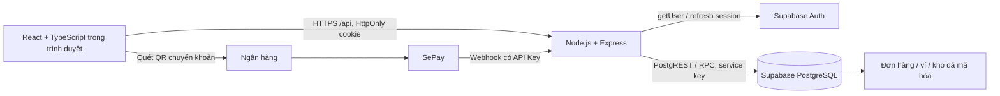
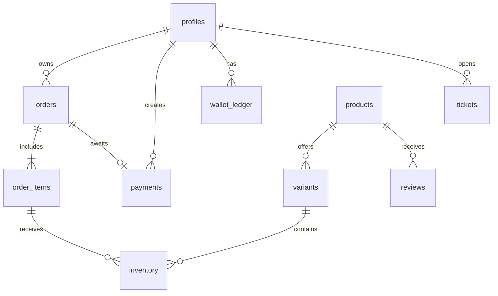
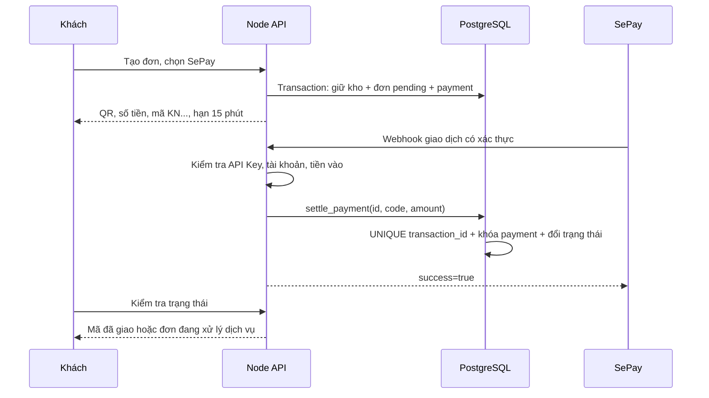
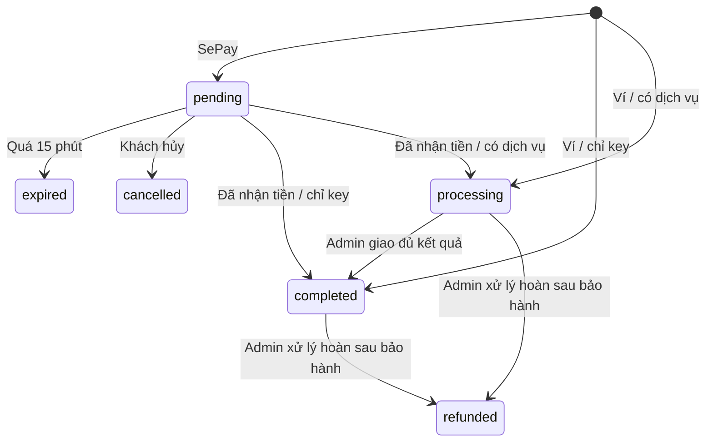

# Kiến trúc và nội dung trình bày đồ án

## Phạm vi

KEYNEST phục vụ khách mua sản phẩm số: game key, gift card, nạp game và MMO/proxy. Hai vai trò là khách hàng và quản trị viên. Dữ liệu/giá/ảnh mẫu để trình diễn; kết nối Supabase và SePay thật được bật bằng cấu hình.

## Kiến trúc

Frontend chỉ lưu giỏ hàng theo thiết bị trong `localStorage`; cookie đăng nhập không đọc được bằng JavaScript. Backend xác thực user với Supabase, kiểm tra role từ `profiles` rồi thực hiện nghiệp vụ. Service key không xuất hiện trong bundle frontend.

## Dữ liệu chính

- `profiles`: tên, email, role, số dư nguyên VND.
- `products`, `variants`: nội dung hiển thị và giá/kiểu giao/tồn kho.
- `inventory`: ciphertext, dấu vân tay chống trùng, gắn với đơn và dòng hàng khi giữ/giao mã.
- `orders`, `order_items`: snapshot tên, giá và số lượng tại thời điểm mua; idempotency key gắn với khách.
- `payments`, `payment_events`: yêu cầu chuyển tiền và sự kiện giao dịch SePay duy nhất.
- `wallet_ledger`: lịch sử tiền tăng/giảm; được ghi cùng transaction với số dư trong Supabase.
- `coupons`, `reviews`, `tickets`, `audit_logs`: khuyến mãi, đánh giá, hỗ trợ và nhật ký.

## Mua bằng ví

1. Trình duyệt gửi `{items, method, coupon, customer_note}` và `Idempotency-Key`.
2. Express kiểm tra schema Zod, phiên đăng nhập, nguồn request và giới hạn tần suất.
3. RPC `create_order` khóa hàng `profiles` của khách rồi các biến thể theo thứ tự ID.
4. RPC đọc giá từ database, kiểm tra tồn, coupon và thông tin dịch vụ.
5. Tạo snapshot đơn, giữ mã/tồn kho, trừ số dư và thêm ledger trong **cùng transaction**.
6. Nếu mọi dòng là key, đơn hoàn thành. Nếu có dịch vụ, đơn `processing`; key có thể được nhận ngay, dịch vụ giao sau.
7. Backend giải mã các bản ghi thuộc đơn được phép trả về, frontend hiển thị trong trang đơn hàng.

Nếu thiếu tiền, thiếu mã hay có lỗi SQL, transaction rollback. Request lặp cùng key/payload trả lại đơn cũ. Cùng key nhưng giỏ hàng khác bị từ chối.

## Mua bằng SePay

Tiền chuyển sai hoặc sau hết hạn không tự thay đổi đơn thành đã thanh toán. `payment_events` lưu `needs_review`; quản trị viên đối soát và cộng tiền thực nhận vào ví. Đơn cũ giữ trạng thái để có lịch sử rõ ràng. RPC đối soát chống cộng trùng.

## Trạng thái

Key đã giao không được trả về kho để tránh bán lại mã mà khách cũ đã nhìn thấy. Dịch vụ giao theo thứ tự dòng hàng hiện trên màn hình; mỗi đơn vị là một dòng kết quả.

## Môn ngôn ngữ kịch bản / Node.js

| Chủ đề                      | Mã minh họa                                             |
| --------------------------- | ------------------------------------------------------- |
| JavaScript ESM, module      | `server/*.js`, `shared/catalog.js`                      |
| Middleware và HTTP REST     | Express trong `server/index.js`                         |
| Bất đồng bộ / Promise       | Supabase adapter, `Promise.all` cho truy vấn độc lập    |
| Kiểm tra dữ liệu vào        | Zod strict schemas và error middleware                  |
| Cookie / phiên / phân quyền | `auth`, `admin`, login/logout/refresh                   |
| File I/O                    | DemoStore ghi tệp tạm rồi đổi tên; chỉ dùng development |
| Crypto                      | `node:crypto`: random, scrypt, timingSafeEqual, AES-GCM |
| Tích hợp hệ thống           | Supabase Auth/PostgREST và webhook SePay                |
| Kiểm thử tự động            | `node:test`, PGlite, Playwright                         |

## Kịch bản demo tại lớp

1. Khách lọc game, chọn biến thể Steam Wallet, xem giá/khu vực.
2. Đăng ký khách mới → ví bằng 0 → tạo nạp 200.000đ → mô phỏng nhận tiền.
3. Mua Hollow Knight bằng ví và coupon → nhận key demo → xem ledger.
4. Tạo đơn game qua SePay → thấy QR/demo thanh toán → xác nhận → nhận mã.
5. Mua proxy có ghi quốc gia → admin giao một dòng endpoint → khách nhận kết quả.
6. Khách gửi ticket → admin trả lời. Hoàn đơn vào ví rồi thử hoàn lần hai.
7. Trình bày các request bị chặn trong `docs/SECURITY.md` và chạy bộ test.

Khi bảo vệ đồ án, phân biệt bằng chứng đã có: test local kiểm tra logic và database; Supabase Auth, SMTP, webhook HTTPS, tài khoản ngân hàng và contention nhiều kết nối cần kiểm thử trên môi trường đã cấu hình thật.
