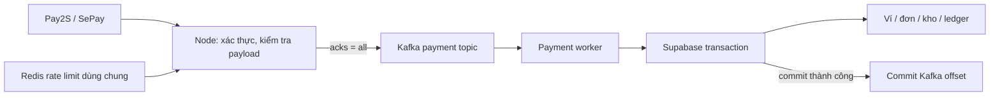

# Kafka + Redis cho xử lý thanh toán

Đã bổ sung chế độ hàng đợi cho cả Pay2S và SePay. Mặc định tắt để demo hiện tại vẫn chạy. Cần Supabase cho API/worker thực tế; không cho chạy Kafka với DemoStore dạng file vì nhiều tiến trình cùng ghi file không an toàn.

## Luồng xử lý



- API trả 200 sau khi Kafka xác nhận ghi sự kiện; **200 nghĩa là đã tiếp nhận**, chưa phải đã cộng ví/giao key. Client tiếp tục xem trạng thái payment trong DB như trước.
- Producer dùng `acks=-1`, idempotent producer, không tự tạo topic. Key partition được băm từ mã thanh toán và tài khoản, gom các sự kiện cùng payment vào một partition.
- Consumer tắt auto-commit, chỉ commit offset kế tiếp sau khi RPC `settle_payment` hoàn thành. Chết giữa DB commit và Kafka commit sẽ đọc lại; `payment_events.transaction_id` và transaction SQL ngăn tác động tài chính lặp lại. Không tuyên bố Kafka và PostgreSQL có chung một transaction.
- DB lỗi được thử lại tối đa 6 lần với thời gian chờ tăng dần. Hết lượt hoặc payload không hợp lệ: dừng worker, giữ offset chưa commit, ghi topic/partition/offset vào log. Không bỏ sự kiện sang DLQ rồi coi là đã xử lý.
- Kafka gửi lỗi/timeout: HTTP 503 để nhà cung cấp thử lại. Không chuyển sang xử lý trực tiếp khi Kafka đang bật. Batch được kiểm tra toàn bộ trước khi gửi; nếu broker đã nhận một phần trước lỗi, các bản gửi lại vẫn được DB chống trùng.
- Redis giữ bộ đếm rate limit bằng script atomic cho các API instance. Khi bật Redis mà kết nối lỗi, request bị chặn với 503 thay vì mất giới hạn truy cập. Webhook có hạn mức riêng 6.000 request/phút/IP, không dùng mức 240 của API thông thường. Đây là giới hạn chống lạm dụng, không phải thông lượng đã đo.
- Đặt hàng/thanh toán bằng ví vẫn là transaction SQL đồng bộ, có Idempotency-Key và khóa tồn kho. Không dùng khóa Redis làm cơ sở đảm bảo số dư hoặc tồn kho. Đã thu hẹp truy vấn sau tạo đơn về đúng ID vừa tạo.

Nguồn: [KafkaJS producer](https://kafka.js.org/docs/producing), [consumer và offset](https://kafka.js.org/docs/consuming), [Redis rate-limit store](https://github.com/express-rate-limit/rate-limit-redis). Kafka idempotent producer không thay thế deduplication trong DB khi nhà cung cấp gửi lại callback hoặc producer khởi động lại.

## Chạy thử trên máy

1. Cài/chạy Docker Desktop với Linux containers và Docker Compose. Máy phải có đủ bộ nhớ cho Kafka; file compose này chỉ phục vụ phát triển, không có HA/TLS/auth, chỉ bind cổng ra localhost.

```powershell
docker compose -f compose.infrastructure.yml up -d --wait
```

Image Kafka local được ghim `apache/kafka:3.9.1` cùng client KafkaJS 2.2.4; tham khảo [hướng dẫn Apache Kafka 3.9](https://kafka.apache.org/39/getting-started/quickstart/). Cần kiểm tra tương thích trước khi tự đổi sang Kafka 4.x. Redis local dùng `redis:7-alpine`, AOF và `noeviction`.

2. Chạy kiểm thử kết nối thật, không cần Supabase và không tác động tiền:

```powershell
npm run test:infra
```

Script tạo topic `keynest-test-<UUID>` rồi xóa đúng topic đó, dùng Redis prefix riêng có TTL. Kiểm tra 100 bộ đếm đồng thời từ hai client Redis và gửi/nhận/commit 100 message Kafka. Không phải benchmark production hoặc test thanh toán ngân hàng thật. Cần quyền tạo/xóa topic thử nghiệm, không chạy script bằng credentials hạn chế chỉ cho topic thanh toán.

3. Cấu hình Supabase/Pay2S theo [PAY2S-SETUP.md](PAY2S-SETUP.md), migration 001–008. Phần này không cần migration SQL mới. Thêm vào `.env`:

```dotenv
APP_MODE=supabase
KAFKA_ENABLED=true
KAFKA_BROKERS=localhost:9092
KAFKA_PAYMENT_TOPIC=keynest.payments.v1
KAFKA_PAYMENT_GROUP=keynest-settlement-v1
KAFKA_CLIENT_ID=keynest-local
KAFKA_WORKER_CONCURRENCY=4
KAFKA_SSL=false
KAFKA_TOPIC_REPLICATION_FACTOR=1
KAFKA_TOPIC_MIN_ISR=1
REDIS_ENABLED=true
REDIS_URL=redis://localhost:6379
REDIS_PREFIX=keynest:
```

Giữ nguyên biến Supabase, bank account, mã hóa và token webhook. Không chạy Kafka với `APP_MODE=demo`. API và worker dùng cùng provider, ngân hàng, topic/group và database.

4. Tạo topic một lần:

```powershell
npm run infra:topics
```

Script tạo 12 partition và retention 7 ngày. Nếu topic đã tồn tại, script không thay đổi cấu hình cũ; phải kiểm tra lại replication/ISR/retention trước khi chạy thật.

5. Chạy hai terminal:

```powershell
# Terminal API/frontend
npm run dev
```

```powershell
# Terminal worker
npm run worker:payments
```

Website/tunnel HTTPS cho webhook vẫn theo hướng dẫn Pay2S. Đừng chỉ chạy API rồi bỏ quên worker: webhook vẫn vào Kafka nhưng tiền chưa được xử lý.

6. Kiểm tra:

```powershell
npm run infra:status
```

Đầu ra hiển thị group state, số worker member, committed offset, high offset và lag theo partition. Admin → Thanh toán cũng hiển thị chế độ Kafka/Redis; đây không phải health check worker. Bật cảnh báo bên vận hành khi group không có member hoặc lag tăng liên tục.

## Vận hành nhiều instance

- Chạy API và worker thành service riêng, có supervisor tự restart khi worker exit 1. Có thể chạy nhiều worker **cùng group ID**; tổng khả năng song song bị giới hạn bởi số partition (12 mặc định) và tài nguyên DB. Tăng từ từ theo số đo DB latency/locks/consumer lag.
- Tất cả API cùng môi trường dùng chung Redis endpoint/prefix và cùng phiên bản route; các môi trường staging/production dùng prefix/topic/group khác nhau. Giới hạn chung trước xác thực theo IP; limiter sau xác thực theo user ID do server xác minh. Cần cấu hình đúng trusted proxy.
- Broker production cần ít nhất 3 replica/topic và min ISR 2, `unclean.leader.election.enable=false`. Script tạo topic từ chối cấu hình nhỏ hơn khi `NODE_ENV=production`. Single-node compose không chịu được hỏng máy/đĩa; không dùng cho tiền thật cần độ sẵn sàng cao.
- Kafka production cấu hình `KAFKA_SSL=true`, `KAFKA_USERNAME`, `KAFKA_PASSWORD`, `KAFKA_SASL_MECHANISM=scram-sha-512` (hoặc cơ chế nhà cung cấp hỗ trợ). Cấp ACL riêng: API được produce, worker được consume topic/group, công cụ quản trị được describe/create theo nhu cầu. Nội dung giao dịch chỉ được phép vào từ nguồn API tin cậy.
- Redis production dùng endpoint có HA, TLS qua `rediss://`, ACL/password và chính sách không tự eviction counter. Tài khoản Redis cần quyền cho các lệnh store sử dụng, gồm SCRIPT LOAD/EVALSHA. Không public cổng Kafka/Redis ra Internet.
- Kafka lưu dữ liệu giao dịch; bảo vệ quyền đọc, TLS, volume và backup/retention. Không có token webhook hay key sản phẩm trong message.

## Kiểm tra lỗi trước khi mở bán

Trên staging dùng ngân hàng/test data phù hợp:

1. Dừng worker; gửi một callback hợp lệ. Kafka lag tăng, số dư chưa đổi. Bật lại worker: lag giảm, transaction chỉ có một bút toán.
2. Gửi lại cùng callback nhiều lần, chạy nhiều worker cùng group. Kiểm tra duy nhất một debit/credit/delivery trong DB.
3. Ngắt Kafka: webhook không được trả thành công. Khôi phục Kafka và cho nhà cung cấp gửi lại. Kiểm tra trường hợp producer timeout nhưng broker đã ghi.
4. Ngắt DB trong khi worker chạy: không commit offset lỗi, worker dừng sau retry. Khôi phục DB rồi restart worker; không cộng hai lần.
5. Ngắt Redis khi API đang chạy: API từ chối qua 503, không tự chuyển sang bộ đếm RAM. Khôi phục Redis rồi thử lại.
6. Đo tải bằng tài khoản/dữ liệu staging: số request/s, p95/p99, tỷ lệ 429/503, lock wait DB, thời gian từ webhook đến settlement và lag. Không tăng concurrency chỉ vì có thêm Kafka.

## Giới hạn và phục hồi

Đơn chuyển khoản vẫn giữ kho 15 phút. Nếu worker xử lý sau hạn, payment có thể đã hết hạn/trả kho; event được chuyển sang đối soát theo logic hiện có, không tự giao hàng đã hết kho. `received_at` ghi thời điểm tiếp nhận để hỗ trợ điều tra, không dùng để bỏ qua kiểm tra hết hạn của DB. Cần giữ lag thấp hơn nhiều so với 15 phút và theo dõi mục đối soát.

Không xóa topic/group, reset offset lên cuối hay xóa `payment_events` để làm hết lag. Khi gặp event lỗi schema, dùng offset trong log để điều tra, khôi phục worker tương thích hoặc xử lý thủ công có đối soát trước mọi thay đổi offset. Tài liệu này không tự bỏ qua các event lỗi. Retention 7 ngày là giới hạn lưu local mẫu: sự cố dài hơn retention cần đối soát lại lịch sử nhà cung cấp; thiết lập retention phù hợp vận hành thật.

Trước đổi provider/tài khoản hoặc tắt Kafka, ngừng nhận mới, để worker xử lý hết backlog, kiểm tra đối soát rồi chuyển cấu hình cả API và worker. Không tắt Kafka rồi bỏ các event đang chờ.

Kiểm thử `npm test` có mô phỏng broker/worker để kiểm tra thứ tự ACK/commit, retry, gửi trùng và lỗi Redis; `npm run test:db` kiểm tra transaction SQL thực tế bằng PostgreSQL WASM. Chúng không thay thế kiểm thử broker thật, nhiều kết nối Supabase đồng thời hoặc ngân hàng thật.
